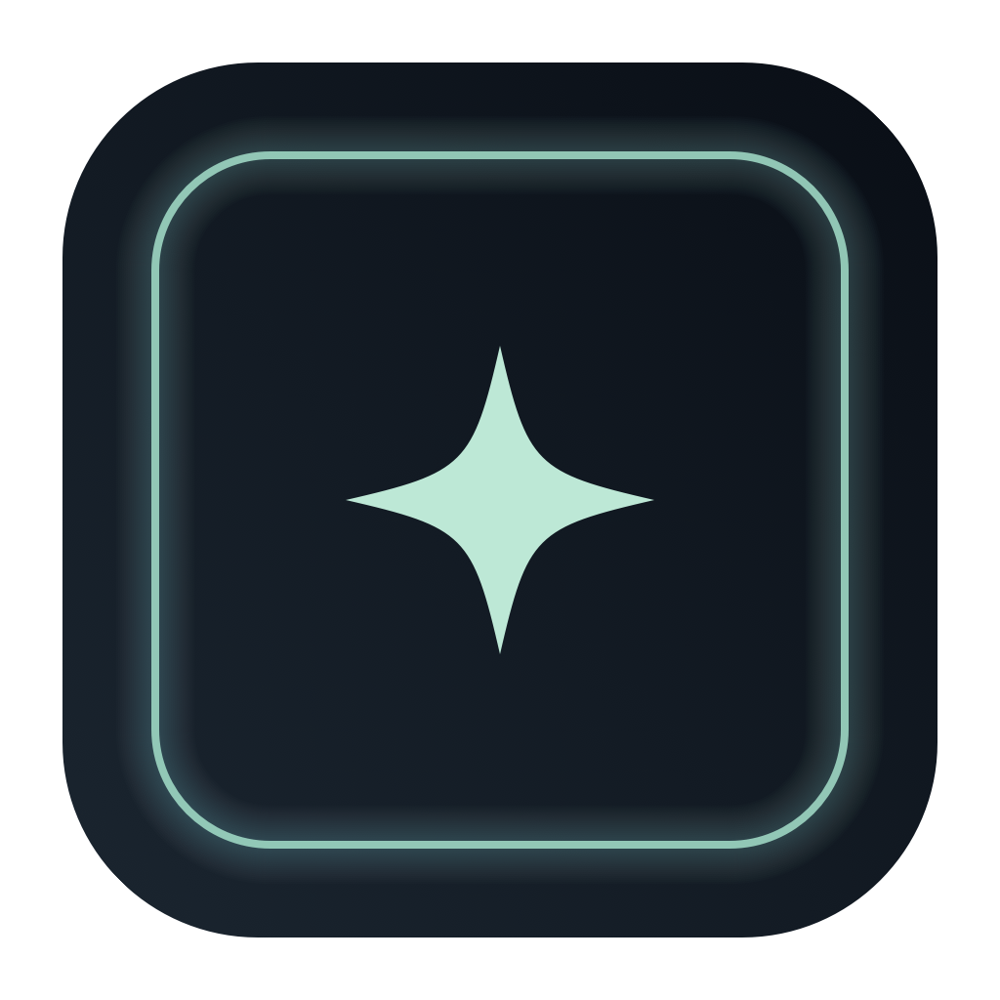
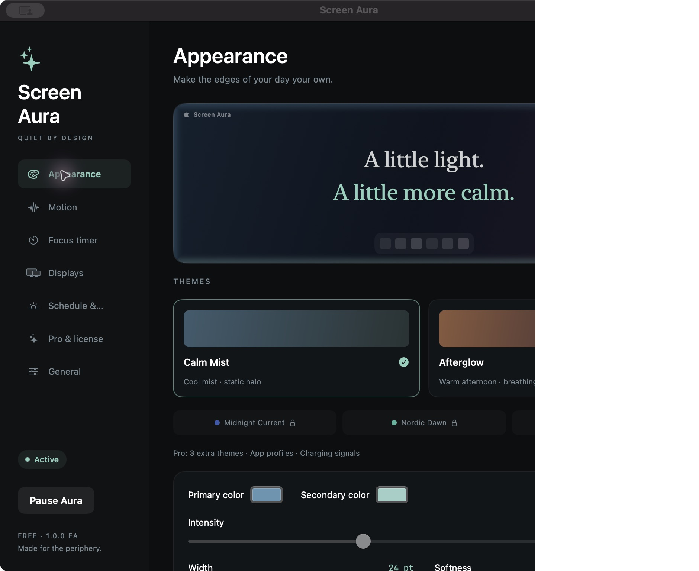
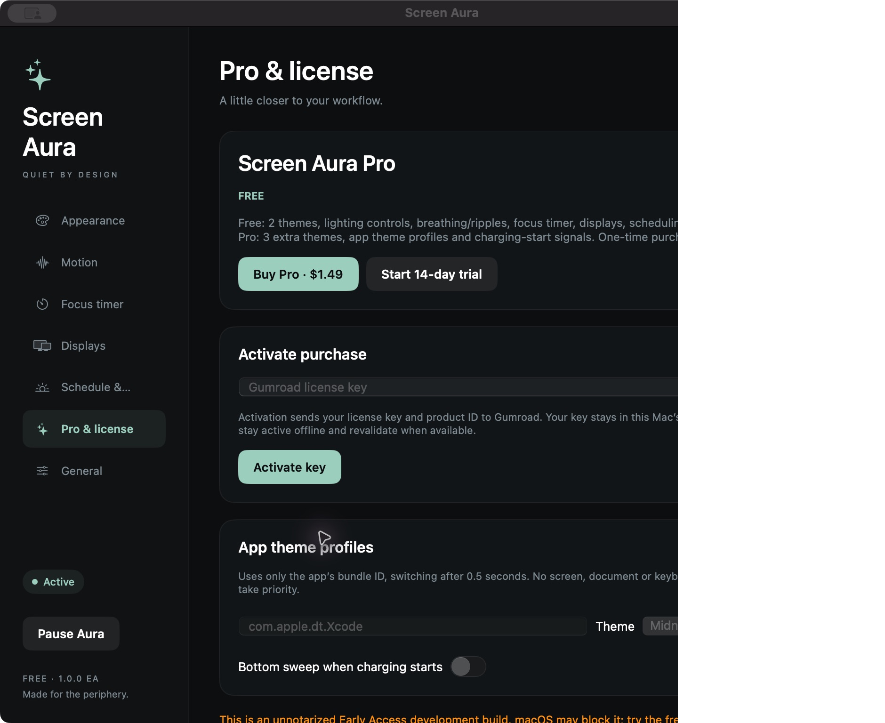

  

<h1 align="center">Screen Aura</h1>

<strong>A little light. A little more calm.</strong>

Gentle edge lighting and quiet focus signals for your Mac.

  
  
  

  <a href="#features">Features</a> ·
  <a href="#free-and-pro">Free &amp; Pro</a> ·
  <a href="#installation">Installation</a> ·
  <a href="#usage">Usage</a> ·
  <a href="#support-and-purchasing">Support &amp; purchasing</a> ·
  <a href="#troubleshooting">Troubleshooting</a> ·
  <a href="#roadmap">Roadmap</a>

Screen Aura is a native macOS menu-bar app that adds a soft halo around your display. Calm colors frame your workspace, breathing adds subtle motion, and brief edge signals mark focus sessions. Transparent overlays pass clicks through and stay out of keyboard focus. Start with a preset, then adjust the light to suit your desktop.

> [!NOTE]
> **1.0.0 Early Access.** [Download Free from GitHub](https://github.com/LEEmj526/screen-aura/releases/download/v1.0.0-ea/ScreenAura-v1.0.0-ea.dmg) or [buy Pro for $1.49 USD](https://1380489593066.gumroad.com/l/screen-aura-pro). The Universal app is ad-hoc signed and **has not been notarized by Apple**. macOS may prevent it from opening; try Free on your Mac before buying. Automatic updates are not included.

  

Actual Free settings window. Three additional themes show Pro locks. English and Korean interfaces are available.

## Features

### Quiet light around your workspace

| Feature | Behavior |
| --- | --- |
| **Edge halo** | Soft gradients along selected edges, with rounded corners and a transparent center. |
| **Breathing** | Core Animation gently varies the light; no continuous CPU frame loop drives it. |
| **Corner ripples and bottom sweeps** | Short signals with bounded queues and cooldowns. |
| **Focus timer** | 1–180 minutes, pause/resume and restart restoration; completion produces one signal. |
| **Day/night schedule** | Switch themes by local time, recalculating for clock and time-zone changes. |
| **Display controls** | Save display choices by UUID; independent overlay windows respond to display changes. Physical multi-display validation remains pending. |

### Ready-made looks

| Preset | Look | Availability |
| --- | --- | --- |
| **Calm Mist** | Quiet blue and pale mint. | Free, Trial, Pro |
| **Afterglow** | Warm peach and muted violet, with breathing. | Free, Trial, Pro |
| **Midnight Current** | Deeper blue and soft indigo. | Trial, Pro |
| **Nordic Dawn** | Fresh mint and pale green. | Trial, Pro |
| **Mono Edge** | A restrained silver-gray halo. | Trial, Pro |

Custom colors, intensity, width, softness, edge selection, insets and corner roundness are available in Free. Changes apply immediately and save automatically.

### Controls that fit your Mac

- **Menu-bar access:** enable or pause Aura, choose a theme and open settings.
- **Accessibility and power:** Reduce Motion and Low Power Mode replace motion with static light; Reduce Transparency reduces opacity.
- **Workflow controls:** exact bundle-ID app exclusions, optional launch at login and Korean/English UI. Sleep or an inactive user session hides the overlays.
- **Local preferences:** JSON import/export, backup and corruption recovery. Purchase keys are excluded from settings exports.
- **Pro app profiles:** switch to an app's saved theme after a 0.5-second debounce. Exclusions take priority.
- **Pro charging signal:** a bottom sweep when a supported internal battery starts charging. No charging signal is shown on Macs without a supported battery.

## Free and Pro

| Feature | Free | Pro / 14-day trial |
| --- | :---: | :---: |
| Calm Mist and Afterglow | ✓ | ✓ |
| Custom colors and all edge controls | ✓ | ✓ |
| Breathing, ripple/sweep previews and focus timer | ✓ | ✓ |
| Display preferences, day/night schedule and app exclusions | ✓ | ✓ |
| JSON import/export and settings recovery | ✓ | ✓ |
| Korean/English UI and optional login launch | ✓ | ✓ |
| Midnight Current, Nordic Dawn and Mono Edge | — | ✓ |
| Automatic themes by app bundle ID | — | ✓ |
| Battery charging-start signal | — | ✓ |

**Pro is $1.49 USD, one-time. No subscription.** The same installer supports both editions. A valid Gumroad license unlocks Pro without reinstalling.

**Try Pro for 14 days.** Open **Settings → Pro & license → Start 14-day trial** when ready. The trial starts only when clicked, needs no card and can be started once while its Keychain record is retained. Quitting or reinstalling does not reset that retained record. At expiry, Free remains available and saved Pro preferences are kept.

## Installation

**[Download Screen Aura 1.0.0 Early Access — free DMG](https://github.com/LEEmj526/screen-aura/releases/download/v1.0.0-ea/ScreenAura-v1.0.0-ea.dmg).** The GitHub download requires no Gumroad account or purchase. [Release notes and SHA-256 checksum](https://github.com/LEEmj526/screen-aura/releases/tag/v1.0.0-ea). A [Gumroad Free download](https://1380489593066.gumroad.com/l/screen-aura-free) is also available for $0.

1. Open the official DMG and drag **ScreenAura.app** into **Applications**.
2. Launch the app if macOS permits this early-access build.
3. The first launch opens settings. Choose Calm Mist or Afterglow and adjust intensity.
4. Use the sparkle icon in the menu bar to return to settings or quit. The app has no Dock icon.

### First launch

This build is ad-hoc signed, **not Developer ID signed or Apple notarized**. A managed Mac or Gatekeeper may prevent opening it. Do not disable macOS security protections. Signing, notarization and clean-Mac installation validation remain release work; test Free before purchasing Pro.

## Usage

### Choose your light

Open **Appearance**, select a theme and tune intensity, width and softness. Use the edge buttons to show only the edges you want. Primary/secondary colors and insets help the halo fit your workspace. **Motion** provides breathing and brief signal previews.

### Focus and scheduling

Open **Focus timer**, choose 1–180 minutes and start a session. Pause/resume or reset it as needed. A deadline restores a running session after restart; an already expired session does not replay an old completion signal. Aura pause clears animations while the focus timer continues.

In **Schedule & exclusions**, configure day/night themes and excluded app bundle IDs. Pro profiles use exact IDs under **Pro & license**. Excluding an app suppresses its halo even when a profile exists.

### Shortcuts and controls

| Action | Where to find it |
| --- | --- |
| Open settings | Menu-bar sparkle / **Command-comma** while the app is active |
| Pause or resume Aura | Menu-bar panel / **Command-Shift-P** while the app is active |
| Control focus timer | Focus page; **Space** when its shortcut is active |
| Start trial or activate key | **Settings → Pro & license** |
| Import/export settings | **Settings → General** |
| Quit and remove overlays | Menu-bar panel / General / **Command-Q** while active |

Shortcuts operate inside the app; global keyboard monitoring is not used. Launch at login is off by default and may require macOS approval.

## Support and purchasing

**[Buy Screen Aura Pro — $1.49 USD, one-time](https://1380489593066.gumroad.com/l/screen-aura-pro).** Gumroad supplies a license key with your purchase. Paste it into **Pro & license → Gumroad license key**, then choose **Activate key**. First activation requires internet. Taxes, conversion and the final total appear at checkout.

The app stores the key in this Mac's Keychain. After activation, cached Pro works offline. Launches recheck a saved license after 24 hours; network failure keeps existing activation. A verified refund, chargeback or invalidated key returns the app to Free. **Forget license** removes the local activation while preserving the trial record. This build does not impose a device-count limit.

Downloading the Free installer or making an optional Free tip does not unlock Pro. The purchase covers current Pro features; future features and dates are not promised. Report reproducible bugs through [GitHub Issues](https://github.com/LEEmj526/screen-aura/issues) or your Gumroad purchase/support channel. Keep license keys out of public reports.

## Troubleshooting

<strong>I cannot find a window.</strong>

Look for the sparkle icon in the menu bar and open settings, or reopen Screen Aura from Applications. Closing settings leaves the menu-bar app running.

<strong>The halo or animation is missing.</strong>

Check Aura enable/pause, display and edge selection, intensity and app exclusions. Sleep, inactive sessions, Reduce Motion and Low Power Mode can change what appears. Try a free theme in a normal desktop app. Fullscreen games, protected screens, Spaces and Stage Manager may limit overlay visibility.

<strong>Some themes and profile controls are locked.</strong>

The three extra themes, app profiles and charging signal require Pro or the explicitly started 14-day trial. Trial expiry returns to Free and retains saved preferences.

<strong>My license is rejected or Gumroad is unavailable.</strong>

Use a key for Screen Aura Pro, not another product. New activation needs an internet connection. A temporary connection failure preserves existing activation; verified refunds or revoked keys return to Free. Contact the seller privately with an order reference. Never post a license key publicly.

<strong>Charging signals do not appear.</strong>

Enable the charging switch in Pro settings. It requires a supported internal battery and a transition into charging; starting the app while already charging does not emit a signal. Desktops without a battery do not offer this signal. Physical cable-transition testing remains pending.

## System requirements

| Item | Current status |
| --- | --- |
| Minimum deployment target | macOS 13.0 |
| Packaged architectures | Apple Silicon (`arm64`) and Intel (`x86_64`) |
| Runtime validation | macOS 15.8.1, Apple Silicon, one display |
| Interface languages | English and Korean |
| Signing | Local ad-hoc signature; not notarized |

The target and Universal build do not certify every Mac. Intel runtime, other macOS versions, physical multi-display/rotation/mixed scale, Spaces, Stage Manager and sustained CPU/GPU/energy measurements still need testing. [Verification results](TEST_RESULTS.md).

## Roadmap

- [x] Native edge lighting, focus timer and bounded animation signals.
- [x] Menu-bar controls, settings and Korean/English UI.
- [x] Display preferences, schedules, accessibility policy and app exclusions.
- [x] Free/Pro enforcement and an explicit 14-day trial.
- [x] Gumroad license verification, Keychain storage and offline activation cache.
- [x] Pro app profiles and battery charging-start observer.
- [x] Universal app and DMG build pipeline.
- [ ] Developer ID signing, notarization and clean-Mac installation validation.
- [ ] Intel, multi-display, additional macOS versions and sustained energy tests.
- [ ] Automatic update distribution.

## Privacy

No analytics, screen recording, global input monitoring or camera/microphone access. Settings and app-profile IDs stay on your Mac; trial/license records stay in Keychain. Activation and rechecks send the license key and product ID to Gumroad using HTTPS. Buyer email and payment data are not stored by the app. [Privacy details](PRIVACY.md).

## Frequently asked questions

<strong>Does Screen Aura modify other apps or display brightness?</strong>

It draws its own transparent overlays. It does not change display hardware brightness, the Dock, menu-bar pixels or other apps' content. Fullscreen visibility cannot be guaranteed for every app.

<strong>Is the implementation source public?</strong>

Implementation source is kept in a private development repository. This public repository contains documentation, screenshots and downloads. GitHub-generated source archives contain distribution documentation, not the app implementation.

<strong>How do I report a problem?</strong>

Include the app/macOS versions, Mac model, display setup, theme and steps to reproduce. Never include license keys, passwords or payment details.

## 한국어

Screen Aura는 화면 가장자리에 잔잔한 빛을 더하는 macOS 메뉴바 앱입니다. 무료는 두 테마·사용자 색상·집중 타이머·시간표·앱 제외·화면 설정을 제공하며, Pro는 **$1.49 일회 구매**로 세 추가 테마·앱별 자동 프로필·충전 시작 신호를 더합니다. 14일 체험은 직접 시작할 때만 적용됩니다. **Apple 공증이 없는 Early Access**이므로 구매 전에 Free가 실행되는지 확인하세요.

## Acknowledgments

Built with **SwiftUI**, **AppKit** and **Core Animation**. Charging observation uses macOS **IOKit** power-source notifications. Purchase activation uses [Gumroad license keys](https://gumroad.com/help/article/76-license-keys). No automatic-update dependency is currently bundled.
